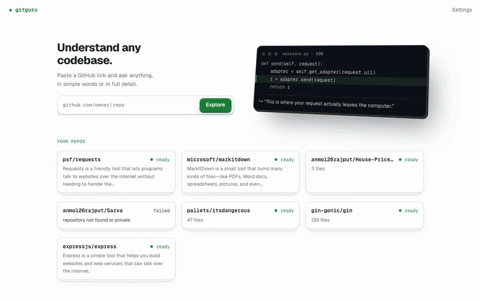
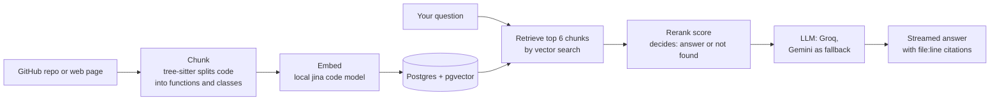

# GitGuru

[](https://github.com/anmol26rajput/gitguru/actions/workflows/ci.yml)

**Talk to any codebase.** Paste a GitHub link, ask a question, and get an answer that points to the exact file and lines it came from.



Live demo: https://<your-app>.vercel.app
<!-- Owner: replace https://<your-app>.vercel.app with your real Vercel URL once the web app is deployed. -->

## What it does

- **Cited answers.** Every claim in an answer carries a number like `[2]`. Each number maps to a file and a line range, such as `src/requests/sessions.py:752-829`. If the code does not contain the answer, GitGuru says so. It does not guess.
- **Click a citation, see the code.** A code panel opens at those lines with the lines highlighted. You can check the answer yourself.
- **Plain words.** Answers avoid jargon and explain code in everyday language. You do not need to be a developer to use it.
- **Diagrams.** The Diagram tab shows what the project does, how it works step by step, and how its main parts connect. The parts diagram is built by parsing the code, not by asking an AI to draw it.
- **A spoken walkthrough.** Ask for a tour. GitGuru opens a file, highlights the lines, and explains them out loud. You can pause, go back and go next.
- **Read aloud.** Any answer can be read to you in a natural voice. If that voice is busy, your browser's own voice takes over.
- **Quality numbers.** The Quality tab tests the search on the repo with generated questions. It shows Hit@5 (is the right code in the top five results?) and MRR (how high does it rank?), so the accuracy is measured, not claimed.
- **Works on phones.** The layout adapts below 900 px. The code panel becomes a bottom sheet and the tap targets are large.
- **Chrome extension.** A side panel for Chrome. On a GitHub repo it asks about that repo. On any other web page it reads the page text and lets you ask about it.

## How it works



Key choices:

- **Cut code at function and class boundaries.** The chunker uses tree-sitter to parse each file, so a chunk is a whole function or class, not an arbitrary slice of lines. On my three benchmark repos (requests, express, gin) this beat fixed line windows in every search mode.
- **Measure, then choose.** I built an eval first. Plain vector search beat keyword plus vector (RRF), and it beat adding a reranker, so answers use vector search. The reranker is kept for one job: it scores the top hits and decides "not found" when nothing fits. Hit@5 averaged 0.89 for vector search on those repos.
- **Embeddings run on the machine.** The jina code model runs locally through fastembed, so indexing costs nothing and no embedding API sees your code. Code goes to the LLM only when it writes an answer, an overview, a walkthrough or Quality questions.
- **One database for everything.** Postgres with pgvector holds the files, chunks, vectors, keyword index and job state. There is no separate vector store to run.
- **Free LLM chain.** Groq answers first. If it fails or hits a rate limit, Gemini takes over. Both are called through one OpenAI-compatible client.

## Try it locally

You need:

- Postgres 17 with the pgvector extension, listening on port 5433
- [uv](https://docs.astral.sh/uv/) (Python 3.12 is picked from `backend/.python-version`)
- Node 22

Create the database, then copy `.env.example` to `.env` in the repo root and fill it in. The backend reads these names:

| Name | What it is |
|---|---|
| `DATABASE_URL` | Postgres connection string. Default `postgresql://localhost:5433/gitguru` |
| `GROQ_API_KEY` | Groq key, the first LLM |
| `GEMINI_API_KEY` | Gemini key, the fallback LLM |
| `APP_TOKEN` | Owner token. Only needed to delete repos and to skip the daily limits |
| `CORS_ORIGINS` | Web app addresses allowed to call the API. Default `http://localhost:3000` |

`GITHUB_TOKEN` is optional. The other settings in `.env.example` have defaults. `.env` is gitignored, never commit it.

```bash
createdb -p 5433 gitguru
createdb -p 5433 gitguru_test   # for the tests

# backend (first run downloads the embedding models)
cd backend
uv sync
uv run uvicorn gitguru.api:app --port 8000

# web, in a second terminal
cd web
npm install
npm run dev
```

Open http://localhost:3000. The schema and the `vector` extension are applied the first time the backend connects. You can also index from the terminal: `uv run gitguru index https://github.com/psf/requests`.

Or run the backend and a database with Docker:

```bash
docker compose up --build
```

That starts the API on http://localhost:7860 and a Postgres with pgvector on port 5434. It reads your `.env` for the API keys. Run the web app on your host with `NEXT_PUBLIC_API_URL=http://localhost:7860 npm run dev`.

## Chrome extension

The side panel lives in `extension/`. It has no build step. See [extension/README.md](extension/README.md) for how to load it and what it can do.

## Tests

CI (`.github/workflows/ci.yml`) runs four jobs on every push and pull request:

- **backend:** 224 pytest tests against a real pgvector Postgres. This includes the eval quality gate, which fails the build if Hit@5 drops below 0.8 on the fixture repo.
- **web:** type check, lint, 37 unit tests, 3 extension tests, and 46 Playwright browser tests. They cover chat, citations, diagrams, voice, the phone layout, the embedded panel, the "Waking up" banner and a real extension loaded into Chromium.
- **gitleaks:** scans the whole git history for secrets.
- **docker:** builds the backend image, checks the grammars are baked in, starts it offline, and waits for a page to reach `ready`.

Run them yourself:

```bash
cd backend && uv run pytest -q
cd web && npm test && npx playwright test
node --test extension/lib/github.test.js
```

The tests use a separate `gitguru_test` database. Run pytest and Playwright one after the other, not together.

## Deploy your own

Everything fits on free tiers.

1. **Neon (database).** Create a project. Copy the **direct** connection string, not the pooler one, and keep its query string as is. You do not need to run any SQL: the backend creates the `vector` extension and the tables the first time it connects.
2. **Hugging Face Space (backend).** Create a new Space with the **Docker** SDK and leave it blank. In its settings add these Space secrets:
   - `DATABASE_URL` (the Neon string)
   - `APP_TOKEN` (any long random string)
   - `GROQ_API_KEY`
   - `GEMINI_API_KEY`
   - `CORS_ORIGINS` (your Vercel URL, for example `https://your-app.vercel.app`)
   - `GITHUB_TOKEN` (recommended: a fine-grained token with public repository read access only. Without it, GitHub's 60 requests an hour per IP are shared with everyone on the Space's IP)
3. **GitHub (deploys the Space).** In your repo, add a secret `HF_TOKEN` (a Hugging Face token with write access) and a repository variable `HF_SPACE` (`your-user/your-space-name`). Then open the Actions tab, pick the **Deploy Space** workflow and click **Run workflow**. It pushes `backend/` to the Space, and the Space builds the Docker image. After that it redeploys on every push to `main` that changes `backend/`. It does not wait for CI, so merge to `main` only when CI is green.
4. **Vercel (web app).** Import the repo. Set the root directory to `web`. Add the environment variable `NEXT_PUBLIC_API_URL` with the value `https://<user>-<space>.hf.space`. Deploy.
5. **Extension.** Open the extension's Options and set the web app URL to your Vercel URL.

Free Spaces go to sleep after 48 hours without traffic. The first visit afterwards wakes the server, and the app shows "Waking up the server…" until it answers. That can take a minute.

## Limits and access

The site is open. Anyone can ask questions with no sign-up and no token.

- **New repos or pages:** 5 a day per visitor. Quality runs count toward the same 5. Across all visitors the total is 20 a day. The day ends at midnight UTC.
- **Questions:** 60 an hour for the whole server, to protect the free LLM quotas. Asking, walkthroughs and new diagram overviews all count. The owner skips this limit.
- **Stored repos:** the server keeps up to 20. A new repo from a guest can replace only another guest's least recently used repo, never one the owner indexed. A guest who adds a repo or page that is already ready just opens it: no re-index, no job spent. Only the owner can refresh it.
- **Storage:** once the database passes 400 MB (`GUEST_DB_MAX_BYTES`, under Neon's 0.5 GB free limit), guests can't add more until the owner deletes some repos.
- **Size:** a repo can be up to 200 MB, 5,000 files and 20,000 chunks. A page can have up to 200,000 characters of text.
- **Owner token:** `APP_TOKEN`, entered in Settings. It is needed only to delete repos and to skip the daily and question limits. Settings → Test connection says whether the saved token is the owner's. Visitors never need it.
